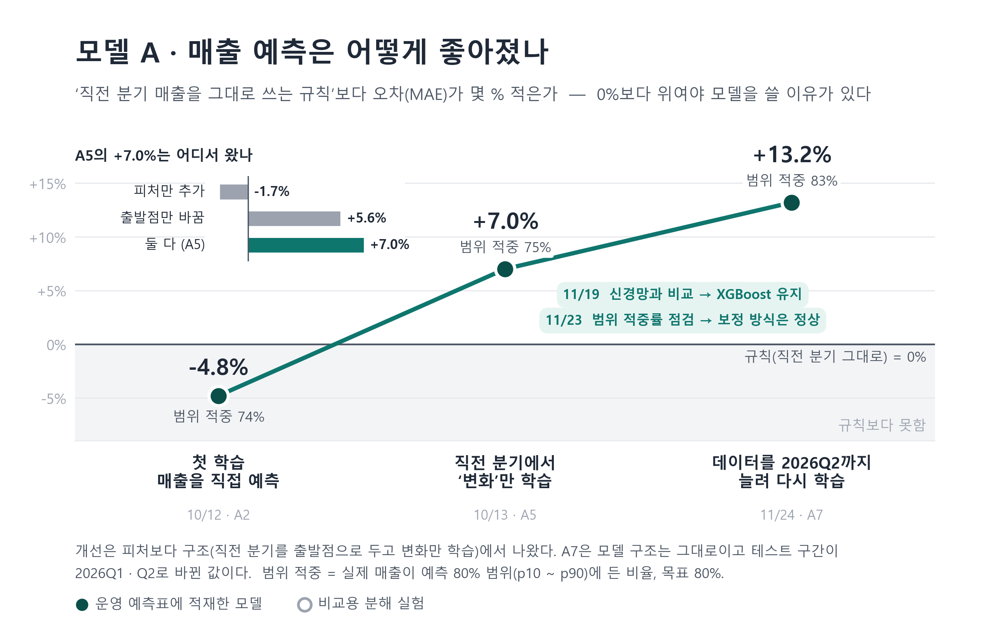
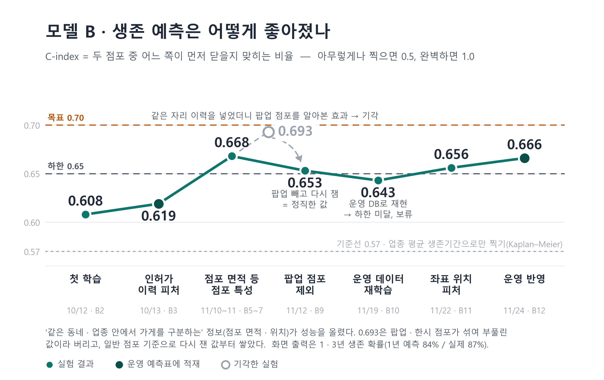

# 모델 개선 과정

10/12 첫 학습부터 11/24 운영 반영까지 두 모델이 어떻게 좋아졌는지 정리한다.
실험 하나하나의 설정과 판단은 노션 「분석계획서」의 '실험 기록' 표가 정본이고, 이 문서는 그 요약이다.
그림은 `python docs/tools/model_improvement.py`로 다시 만든다.

## 모델 A · 매출

**기준은 "직전 분기 매출을 그대로 쓰는 규칙(naive)"이다.** R²는 직전 분기를 베끼기만 해도 0.9를 넘으므로,
모델을 쓸 이유는 이 규칙보다 오차(MAE)가 얼마나 적은지로 보여 준다.

| 실험 | 날짜 | 바꾼 것 | naive 대비 오차 | 80% 범위 적중 | R² |
| --- | --- | --- | ---: | ---: | ---: |
| A2 | 10/12 | XGBoost 분위수 회귀로 매출을 직접 예측 | -4.8% | 74.2% | 0.889 |
| A5 | 10/13 | 직전 분기 매출을 출발점으로 두고 **변화만** 학습 + 추세 · 매출 구성 피처 | +7.0% | 74.9% | 0.934 |
| A7 | 11/24 | 구조는 A5 그대로, 데이터를 2026Q2까지 늘려 재학습(테스트 2026Q1 · Q2) | **+13.2%** | **82.8%** | 0.942 |

- **개선은 구조에서 나왔다.** A5를 분해하면 출발점만 바꿔도 +5.6%, 피처만 더하면 -1.7%였다.
- **11/19 신경망 비교** — 같은 입력 · 같은 시간 분할로 신경망 설정 3개를 비교했다. 2025년 하반기 30,190행에서
  MAE는 XGBoost 738.4만 원, 신경망 744.8만 ~ 748.0만 원이라 XGBoost를 유지했다.
- **11/23 범위 적중률 점검(A6)** — 74.9%가 목표 80%에 못 미친 원인을 찾았다. 보정 방식을 바꿔도 ±0.2%p였고
  검증셋에서는 정확히 80.0%가 나와, 2025년 하반기 테스트 구간 탓으로 판단하고 보정 규칙은 그대로 뒀다.
  새 테스트 구간(A7)에서 82.8%가 나와 이 판단이 맞았다.
- A2 → A5 → A7은 모두 테스트 구간이 다르거나 같은 구간을 다시 쓴 비교다. A7의 상승분에는 테스트 구간이 바뀐 효과가 섞여 있다.

## 모델 B · 생존

**C-index는 두 점포 중 어느 쪽이 먼저 닫을지 맞히는 비율이다**(무작위 0.5, 완벽 1.0). 목표 0.70, 운영 반영 하한 0.65.
테스트는 2024년 이후 개업 점포(35,307건)로 고정했다.

| 실험 | 날짜 | 바꾼 것 | C-index | 업종 내 C |
| --- | --- | --- | ---: | ---: |
| B2 | 10/12 | XGBoost AFT 첫 학습(영업 중 점포도 버리지 않는 생존분석) | 0.608 | 0.555 |
| B3 | 10/13 | 인허가 이력 피처 · 2016년 개업부터 학습 · 1 · 3년 생존 확률로 출력 → **운영 적재** | 0.619 | 0.571 |
| B5 ~ B7 | 11/10 ~ 11 | 점포 면적 · 같은 상호 이전 점포 수 · 지하 · 다중이용업소(시드 3개 평균) | 0.668 | 0.628 |
| ~~B8~~ | 11/12 | 같은 자리 이력 피처 — **기각**(아래) | ~~0.693~~ | ~~0.653~~ |
| B9 | 11/12 | 팝업 · 한시 점포(상호 키워드, 0.57%)를 학습 · 평가에서 제외 | 0.653 | 0.616 |
| B10 | 11/19 | 운영 DB로 재학습 — B9가 재현되지 않아 하한 미달, 적재 보류 | 0.643 | 0.608 |
| B11 | 11/22 | 인허가 좌표 위치 피처(반경 내 동종 점포 수 · 최근접 거리 · 최근 폐업 수) | 0.656 | 0.620 |
| B12 | 11/24 | 좌표 운영 반영 · 2026 데이터로 재학습 → **운영 적재** | **0.666** | **0.631** |

- **기각한 0.693** — 같은 자리에 먼저 있던 점포 이력을 넣자 C가 크게 올랐는데, 점검해 보니 백화점 · 쇼핑몰 팝업처럼
  한 좌표에 점포가 몰린 곳을 알아보는 효과였다. 서비스가 답하는 것은 "지금 일반 점포를 연다면"이라 버리고,
  팝업을 뺀 일반 점포 기준(B9 0.653)으로 다시 쌓았다. B5a(빈 면적을 중앙값으로 채움, 0.687)도 누수라 같은 이유로 기각했다.
- 성능을 올린 것은 모델이 아니라 **같은 동네 · 업종 안에서 가게를 구분하는 정보**(점포 면적 · 위치)였다.
  처음 피처는 모두 행정동 × 업종 단위라 같은 칸의 점포끼리는 구분하지 못했다.
- 화면에 나가는 것은 C-index가 아니라 1 · 3년 생존 확률이다. B12의 1년 생존 확률은 예측 84.4% / 실제 87.4%,
  Brier 0.104(모두에게 평균을 주는 기준선 0.110)다. 기준선 C는 업종별 Kaplan–Meier 0.568, Cox 0.649.
- 목표 0.70은 아직 못 넘었다. 남은 후보는 가맹 브랜드 목록 · 업종별 모델 · 하이퍼파라미터 탐색이다.

## 종합점수 가중치

두 모델의 결과와 성장세를 합치는 비율은 과거 두 시점(T = 2024Q4 · 2025Q2)을 재현한 백테스트로 정했다(R3 · R4, 10/13).

| 매출 · 생존 · 성장세 | 실제 매출 순위 상관 | 실제 폐업률 순위 상관(음수가 좋음) |
| --- | ---: | ---: |
| 40 · 40 · 20 (처음) | 0.79 | -0.075 |
| **60 · 30 · 10 (채택)** | **0.90** | -0.068 |
| 매출만 | 0.94 | -0.048 |

두 시점 평균이다. 폐업률 상관은 생존 예측이 있는 15개 업종에서 쟀다. 60 · 30 · 10은 매출 순위를 크게 되살리면서
폐업 신호를 대부분 남기는 지점이다.
