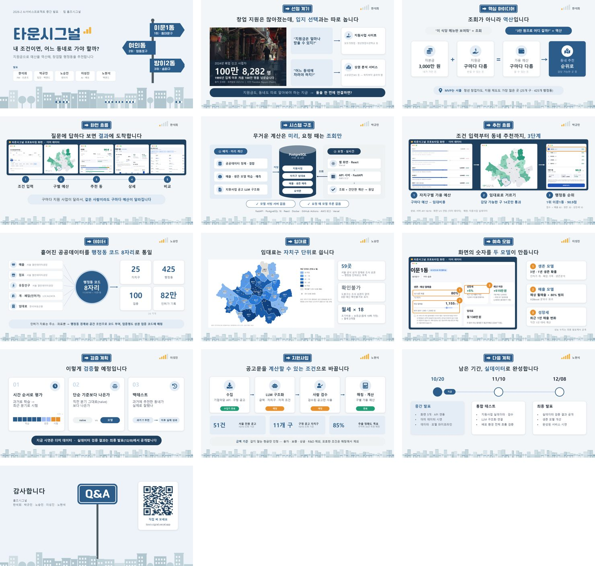

# 발표 자료

## 2026-10-20 중간 발표

홈즈시그널 · 팀당 5분 · 1인 약 1분. 파일: [2026-10-20_midterm.pptx](2026-10-20_midterm.pptx) — 슬라이드마다 발표자 노트에 대본이 들어 있다.

| 순서 | 발표자 | 슬라이드 | 내용 |
| --- | --- | --- | --- |
| 1 | 한석희 | 1 ~ 4 | 표지 · 선정 계기 · 역산 아이디어 · 화면 흐름 |
| 2 | 박규민 | 5 ~ 6 | 시스템 구조 · 추천 3단계 |
| 3 | 노승민 | 7 ~ 8 | 공공데이터 통합 · 임대료 |
| 4 | 이성진 | 9 ~ 10 | 예측 모델 · 검증 계획 |
| 5 | 노현석 | 11 ~ 13 | 지원사업 데이터 · 다음 계획 · Q&A |

- 시연 화면은 더미 데이터 기준이다. 모델 성능 수치는 최종 발표에서 공개한다.
- 2번 장의 폐업 수치: 국세청 국세통계(세계일보, 2025.7.6). 사진: Theodore Nguyen (Pexels, 무료 라이선스).
